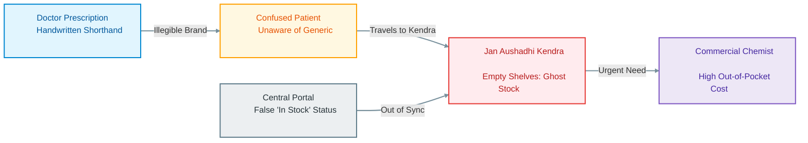
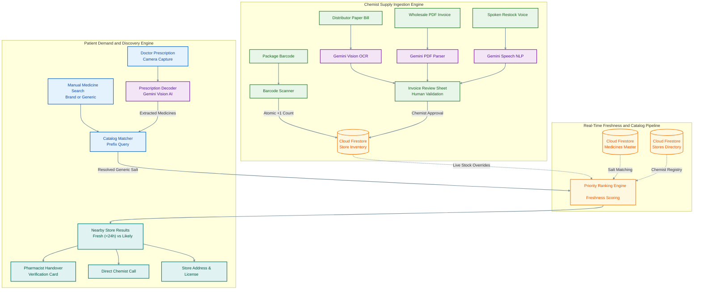
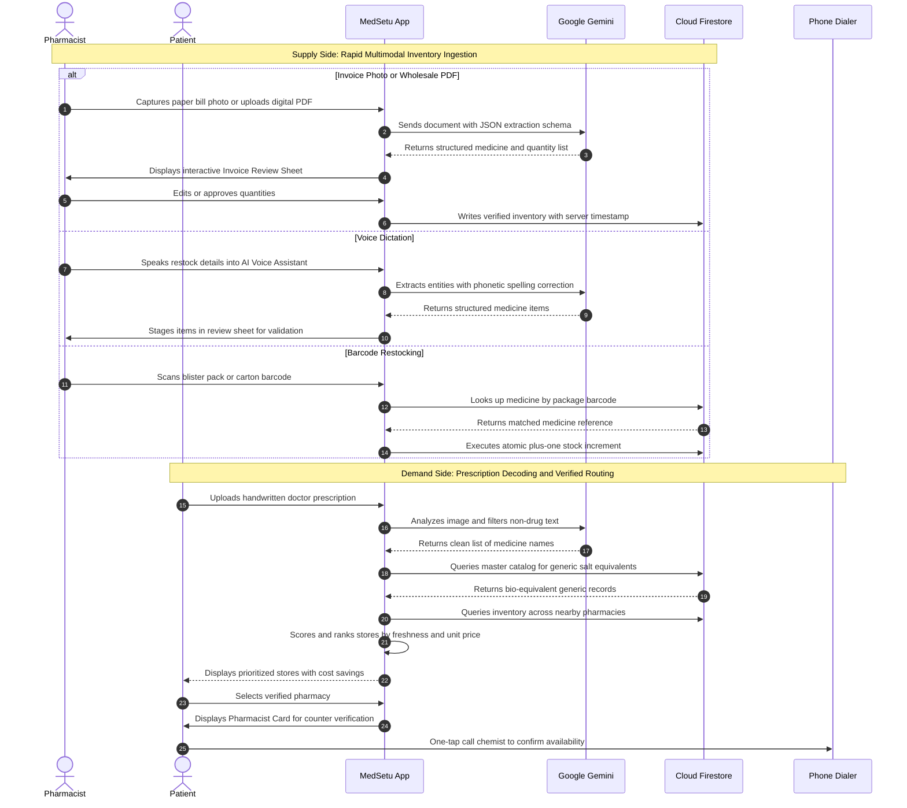
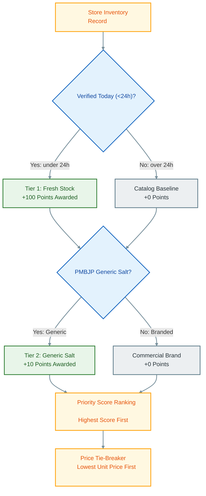
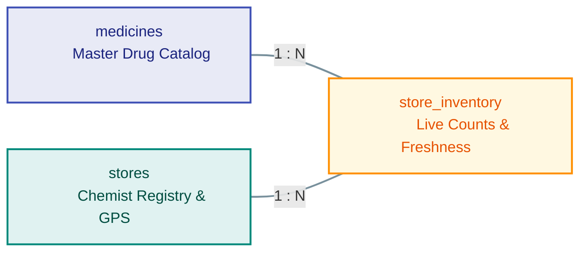
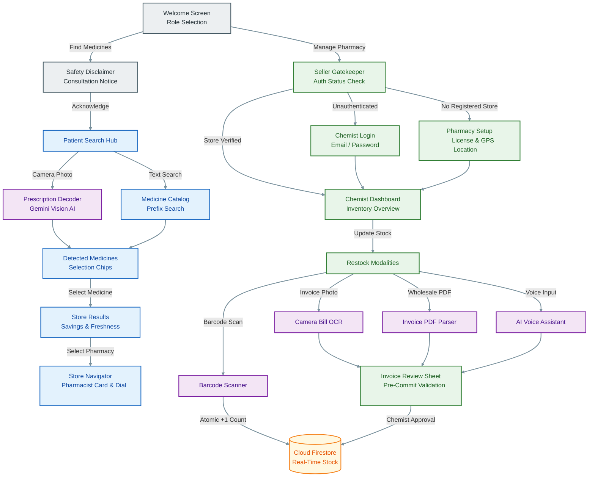

<div align="center">

  

  # 💊 MedSetu (मेडसेतु)
  ### *Bridging doctor handwriting, affordable generic medicines, and verified pharmacy inventory.*

  **Built for the GDG VESIT TechSprint Hackathon**  
  **Crafted by [Parth Chavan](https://github.com/Parth-Chavan-15)**

  <p align="center">
    <a href="https://flutter.dev"></a>
    <a href="https://dart.dev"></a>
    <a href="https://ai.google.dev"></a>
    <a href="https://firebase.google.com"></a>
    <a href="https://pub.dev/packages/geolocator"></a>
  </p>

  <p align="center">
    <strong>MedSetu (मेडसेतु)</strong> is a dual-agent healthcare platform engineered to make affordable life-saving medicines accessible to every citizen under India's <i>Pradhan Mantri Bhartiya Janaushadhi Pariyojana (PMBJP)</i>. It couples <b>rapid, zero-friction inventory logging</b> for local chemists (via distributor bill OCR, wholesale PDFs, voice dictation, and barcode scans) with a <b>visual prescription AI decoder</b>, <b>bio-equivalent generic substitution engine</b>, and <b>same-day shelf freshness verification</b> for patients.
  </p>

  <p align="center">
    <a href="#-the-problem-the-ghost-stock-reality">The Problem</a> •
    <a href="#-the-medsetu-dual-agent-solution">The Solution</a> •
    <a href="#-key-capabilities">Key Capabilities</a> •
    <a href="#-system-architecture">Architecture</a> •
    <a href="#-algorithmic-intelligence-priority-ranking">Ranking Engine</a> •
    <a href="#-medical-liability--safety-protocols">Safety Protocols</a> •
    <a href="#-data-architecture--synchronization">Data Model</a> •
    <a href="#-quick-start">Quick Start</a> •
    <a href="#-application-navigation-flow">Navigation Flow</a>
  </p>

</div>

---

## 🚨 The Problem: The "Ghost Stock" Reality

Under the Government of India’s **Pradhan Mantri Bhartiya Janaushadhi Pariyojana (PMBJP)**, authorized Kendras provide certified generic medicines at **50% to 90% cheaper rates** than commercial brands.

Despite this nationwide initiative, millions of citizens still buy costly branded drugs out-of-pocket because the supply chain fails at the critical "last mile":



1. **The "Ghost Stock" Paradox**: Government directories assume local pharmacies carry catalog items. In reality, independent pharmacists are overwhelmed by counter sales and lack the time or tools for cumbersome manual database entry into legacy desktop ERPs. Physical shelves run dry, while central portals continue reporting false availability.
2. **The Handwriting & Brand Shorthand Barrier**: Prescriptions are written in hurried doctor shorthand using commercial brand names (such as *Augmentin 625*, *Dolo 650*, or *Pan-D*). Patients have no accessible way to decode these into active generic chemical formulations (such as *Amoxicillin + Clavulanic Acid* or *Paracetamol 650mg*).
3. **Wasted Journeys & Desperation Purchases**: Patients travel miles across town to a Jan Aushadhi Kendra, only to find the medicine out of stock. In urgent medical distress, they walk into a nearby retail chemist and pay full market price out-of-pocket.

---

## 💡 The MedSetu Dual-Agent Solution

MedSetu replaces passive, out-of-date directories with an **AI-driven real-time supply and demand ecosystem**:

| Operational Challenge | Traditional System | MedSetu Dual-Agent Ecosystem |
| :--- | :--- | :--- |
| **Inventory Logging** | Tedious manual typing into legacy desktop software (rarely performed). | **Multimodal Zero-Click Ingestion**: Ingest stock in seconds via distributor bill photos, wholesale PDFs, voice dictation, and barcode scans. |
| **Prescription Decoding** | Patients struggle to read physician handwriting and brand shorthand. | **Multimodal Vision AI**: Gemini Vision extracts medicine names directly from prescription photos and filters out dosage notes. |
| **Stock Accuracy** | Unverified catalog assumptions ("Ghost Stock"). | **Two-Tier Freshness Engine**: Clearly separates 🟢 **Verified Fresh Stock (<24h)** from 🟡 **Likely Available (≥24h)**. |
| **Price Transparency** | Patients remain unaware of low-cost generic equivalents. | **Smart Price Savings Engine**: Automatic mapping to bio-equivalent generic salts with direct side-by-side cost comparisons in ₹. |
| **Dispensing Safety** | Unregulated app suggestions create liability and safety risks. | **3-Tier Medical Safety Matrix**: Mandatory launch disclaimer, human-in-the-loop review, and an in-app counter **Pharmacist Handover Card**. |

---

## ✨ Key Capabilities

### 🏪 1. The Chemist Agent (Zero-Friction Supply Ingestion)
Engineered for busy local pharmacists and Jan Aushadhi Kendra operators who cannot spend hours typing data.

* **📸 Distributor Paper Bill OCR**: Snap a quick photo of a wholesale paper invoice. Google Gemini Vision extracts medicine names and quantities into structured data in seconds.
* **📄 Wholesale PDF Ingestion**: Directly upload digital distributor invoice PDFs to parse multi-item wholesale deliveries in a single tap without manual typing.
* **🎙️ Voice-to-Ledger Dictation**: Tap the microphone and speak naturally (e.g., *"Received 50 strips of Metformin 500mg and 20 bottles of Cetirizine"*). The NLP engine parses quantities and automatically corrects Indian pharmaceutical phonetic spellings.
* **📦 Blister Pack Barcode Restocking**: Integrated camera barcode scanner reads medicine cartons and blister packs, performing atomic quantity increments in Cloud Firestore with instant haptic feedback.
* **🧑‍💻 Human-in-the-Loop Review Sheet**: Prevents AI extraction inaccuracies from touching production inventory. Chemists review, adjust quantities, and remove items on an interactive bottom sheet before confirming updates.

---

### 🧑‍🦳 2. The Patient Agent (Intelligent Demand & Safe Discovery)
Engineered for citizens, elderly patients, and caregivers seeking reliable, affordable medicines.

* **👁️ Handwritten Prescription Decoder**: Upload a photo of a doctor's prescription. Gemini Vision OCR identifies brand and generic medications while filtering out handwriting artifacts, frequencies, and dosage noise.
* **🔄 Automatic Generic Substitution & Price Comparison**: Cross-references prescribed commercial brands with bio-equivalent Jan Aushadhi generic salts, displaying transparent cost savings in ₹.
* **🟢 Real-Time Shelf Freshness Verification**:
  * 🟢 **Verified Fresh Stock (<24h)**: Stock verified on shelves today via distributor bill OCR, PDF, voice, or barcode. Zero ghost-stock risk.
  * 🟡 **Likely Available (≥24h)**: Baseline catalog listing without same-day chemist confirmation. Patients are encouraged to call ahead.
* **🤝 The Pharmacist Card (Liability Shield)**: An in-app handover screen designed for counter presentation to licensed chemists:
  > *"Hello Pharmacist, please verify if [Generic Salt] is a valid substitute for [Prescribed Brand] prescribed here."*
* **📞 One-Tap Chemist Contact**: Embedded pharmacy contact card with direct phone calling to verify stock before traveling.

---

## 🏗️ System Architecture



<div align="center">
  <sub>Dual-agent architecture: supply-side rapid restocking meets demand-side prescription decoding and freshness-ranked discovery.</sub>
</div>

<br/>

<details>
<summary><b>🔍 View detailed End-to-End Sequence Workflow (click to expand)</b></summary>

<br/>



</details>

---

## ⚡ Algorithmic Intelligence: Priority Ranking

To eradicate ghost stock, MedSetu calculates a dynamic **Priority Score** for each pharmacy carrying the requested medicine, prioritizing verified shelf freshness, generic availability, and affordability:

$$\text{Priority Score} = \left(100 \times \mathbf{1}_{\Delta t \lt 24\text{ h}}\right) + \left(10 \times \mathbf{1}_{\text{Generic}}\right)$$

$$\text{Tie-Breaker} = \min(\text{Unit Price})$$

### Priority Evaluation Pipeline



| Evaluation Stage | Scoring Mechanism | Operational Impact for Patients |
| :--- | :--- | :--- |
| **Tier 1: Physical Freshness** | `+100 pts` if verified within `< 24 hours` | Guarantees zero wasted trips by prioritizing pharmacies whose shelves were restocked today. |
| **Tier 2: Generic Preference** | `+10 pts` if authorized PMBJP generic | Prioritizes government affordable generic salts over commercial branded alternatives. |
| **Tier 3: Price Tie-Breaker** | $\min(\text{Unit Price})$ | When availability and formulation match, automatically routes patients to the most economical store. |

### Real-Time Availability Indicators

| Indicator | Status Tier | Verification Window | Operational Meaning |
| :---: | :--- | :--- | :--- |
| `🟢` | **Verified Fresh Stock** | Updated within `< 24 hours` | Physical shelf stock confirmed today via invoice OCR, wholesale PDF, voice, or barcode. Zero ghost-stock risk. |
| `🟡` | **Likely Available** | Updated `≥ 24 hours` or catalog default | Expected baseline catalog listing without same-day restock confirmation. Patients are advised to call before visiting. |

---

## 🛡️ Medical Liability & Safety Protocols

> [!IMPORTANT]
> **MedSetu is an informational bridge, not a prescribing authority.**  
> Under Indian drug regulations (Drugs and Cosmetics Act), Schedule H and H1 medications must be verified and dispensed by a licensed pharmacist.

### 3-Tier Medical Safety Architecture

| Safety Layer | Implementation Mechanism | Clinical & Regulatory Safeguard |
| :--- | :--- | :--- |
| **1. Mandatory Gate Modal** | First-launch acknowledgment dialog | Mandates explicit user confirmation: *"Always verify medicines with a registered Pharmacist before purchase."* |
| **2. The Pharmacist Card** | In-app counter presentation token | Hands substitution authority to licensed chemists before dispensing Schedule H/H1 drugs. |
| **3. Chemist Review Gate** | Interactive pre-commit review sheet | Prevents unverified AI vision or voice extractions from touching live database records without human sign-off. |

1. **Mandatory Launch Disclaimer**: Users must explicitly acknowledge:  
   `"Always verify medicines with a registered Pharmacist before purchase."`
2. **The Counter Handshake Card**: Before traveling, the app generates a dedicated handover token:  
   `"Hello Pharmacist, please verify if [Generic Salt] is a valid substitute for [Prescribed Brand] prescribed here."`
3. **Chemist Review Gate**: AI vision and voice extractions are never written directly to the database; they populate an interactive editable sheet requiring human validation.

---

## 🗄️ Data Architecture & Synchronization

MedSetu uses a relational document model in Cloud Firestore designed for real-time querying, high availability, and low read latency:



| Collection | Core Responsibility | Key Relational Pointers | Real-Time Sync Triggers |
| :--- | :--- | :--- | :--- |
| **`medicines`** | Master drug directory mapping commercial brands to active generic chemical salts, package barcodes, and standard MRPs. | `generic_source_ref` &rarr; parent generic salt | Administrative master catalog updates |
| **`stores`** | Verified pharmacy registry storing chemist credentials, state drug licenses, contact numbers, and geographic coordinates. | `owner_uid` &rarr; authenticated chemist UID | Store registration and profile management |
| **`store_inventory`** | Real-time shelf inventory linking physical pharmacies to medicines, tracking live quantities, unit prices, and status. | `store_ref` &rarr; `stores`<br/>`medicine_id` &rarr; `medicines` | Distributor bill OCR, PDF bills, voice dictation, barcode restock |
| **`users`** | Authentication and profile registry for patients and pharmacists. | `uid` &rarr; Firebase Auth UID | User sign-up and authentication lifecycle |

### Security & Access Rules
* **Public Read Access**: The `medicines`, `stores`, and `store_inventory` collections permit open read access so patients can search for medicines and check availability without mandatory account registration.
* **Protected Write Access**: Modifying inventory records and store profiles strictly requires active Firebase Authentication tied to the pharmacy's verified owner UID.

---

## 🚦 Quick Start

Follow these steps to run MedSetu on your development machine or mobile device.

### 1. Prerequisites
Ensure you have the following installed on your system:
* **Flutter SDK**: `3.x` (Dart SDK `>= 3.0.0 < 4.0.0` from [flutter.dev](https://docs.flutter.dev/get-started/install))
* **Android Studio**: With Android SDK 35 installed (or Xcode if running on macOS for iOS)
* **Google AI Studio API Key**: A free Gemini API key from [aistudio.google.com](https://aistudio.google.com/)

### 2. Clone the Repository
```bash
git clone https://github.com/Parth-Chavan-15/MedSetu-TechSprint.git
cd MedSetu-TechSprint
```

### 3. Install Packages
Install all Flutter and Dart package dependencies:
```bash
flutter pub get
```

### 4. Configure Google Gemini API Key
MedSetu uses Google Gemini 2.5 Flash for prescription vision decoding, invoice OCR, and voice parsing. Add your API key in the client configuration files:

| Target File | Configuration Parameter | Purpose |
| :--- | :--- | :--- |
| `lib/backend/gemini/gemini.dart` | `_kGeminiApiKey = 'YOUR_KEY'` | Client SDK initialization for generative vision and text |
| `lib/backend/api_requests/api_calls.dart` | `'x-goog-api-key': 'YOUR_KEY'` | REST API headers for prescription, invoice, and voice pipelines |

> [!NOTE]
> Pre-configured Firebase settings (`android/app/google-services.json` and `ios/Runner/GoogleService-Info.plist`) are already bundled in the repository for testing with the live hackathon database.

### 5. Launch the Application
```bash
# Clean cached build artifacts
flutter clean
flutter pub get

# Launch on connected Android emulator or physical device
flutter run

# Or launch on Google Chrome
flutter run -d chrome
```

### 6. What Success Looks Like
When the application boots, you will see the welcome screen displaying the circular MedSetu logo and two primary options:
* **Find Medicines**: Opens the patient prescription scanner and generic medicine directory.
* **Manage Pharmacy**: Opens the chemist authentication portal and inventory restocking dashboard.

---

## 🧭 Application Navigation Flow



---

## 🛠️ Tech Stack & Dependencies

| Layer | Technology | Primary Role in MedSetu |
| :--- | :--- | :--- |
| **Core Framework** | Flutter 3.x (Dart 3.x) | Cross-platform client architecture targeting Android, iOS, and Web |
| **UI & State Engine** | FlutterFlow, Provider, Google Fonts, Flutter Animate | Reactive UI components, state lifecycle management, and micro-interactions |
| **AI & Multimodal Vision** | Google Gemini 2.5 Flash (`google_generative_ai`) | Prescription vision OCR, wholesale invoice parsing, and voice NLP |
| **Backend & Cloud Database** | Google Cloud Firestore, Firebase Storage | Low-latency document storage, real-time sync, and asset persistence |
| **Authentication** | Firebase Auth | Role-gated chemist authentication and secure user sessions |
| **Hardware & Scanning** | `flutter_barcode_scanner`, `image_picker`, `file_picker` | Blister pack barcode reading, camera document captures, and PDF ingestion |
| **Geo & Communication** | `geolocator`, `url_launcher` | Chemist GPS coordinate capture, phone dialer integration, and external launching |

---

## 📁 Project Structure

```text
MedSetu-TechSprint/
├── android/                 # Android native project and Gradle configuration (SDK 35)
├── ios/                     # iOS native workspace and Podfile
├── assets/                  # Fonts and brand imagery
│   └── images/              # Official MedSetu logo (WhatsApp_Image_2026-01-14_at_20.38.53.jpeg)
├── firebase/                # Cloud Firestore rules, security indexes, and Cloud Functions
│   ├── firestore.rules      # Firestore collection security rules
│   └── functions/           # Node.js Firebase functions
├── lib/                     # Application source code
│   ├── authentication_pages/# Seller login, gatekeeper check, and shop registration
│   ├── backend/             # Firebase configuration, Firestore schema, and Gemini API calls
│   │   ├── api_requests/    # AnalyzePrescription, AnalyzeInvoice, AnalyzeText calls
│   │   ├── gemini/          # Google Generative AI client
│   │   └── schema/          # Firestore record wrappers (medicines, stores, inventory, users)
│   ├── custom_code/         # Custom actions (convertImageToBase64, convertNamesToRefs)
│   ├── flutter_flow/        # Theme definitions, navigation router, and custom functions
│   │   ├── custom_functions.dart # Priority ranking and status color logic
│   │   └── nav/             # GoRouter route declarations
│   ├── home_page/           # Welcome screen and dual-role selector
│   ├── patient_pages/       # Prescription scanner, store results, and store navigator
│   ├── seller_pages/        # Restock modalities, invoice review sheet, and barcode scanner
│   └── main.dart            # Application entry point and router initialization
└── pubspec.yaml             # Dart environment and Flutter package dependencies
```

---

## 🏆 Project Context

* **Event**: GDG VESIT TechSprint Hackathon
* **Domain**: Healthcare Accessibility, Multimodal AI, and Public Health Logistics
* **Mission**: Eliminating out-of-pocket medical expenditure by bringing real-time data transparency to India's *Pradhan Mantri Bhartiya Janaushadhi Pariyojana (PMBJP)*.

---

## 👨‍💻 Author

**Parth Chavan**
* GitHub: [@Parth-Chavan-15](https://github.com/Parth-Chavan-15)
* Repository: [MedSetu-TechSprint](https://github.com/Parth-Chavan-15/MedSetu-TechSprint)

---

<div align="center">
  <sub>Built with ❤️ by Parth Chavan to make affordable healthcare a reality for every Indian citizen. 🇮🇳</sub>
</div>
