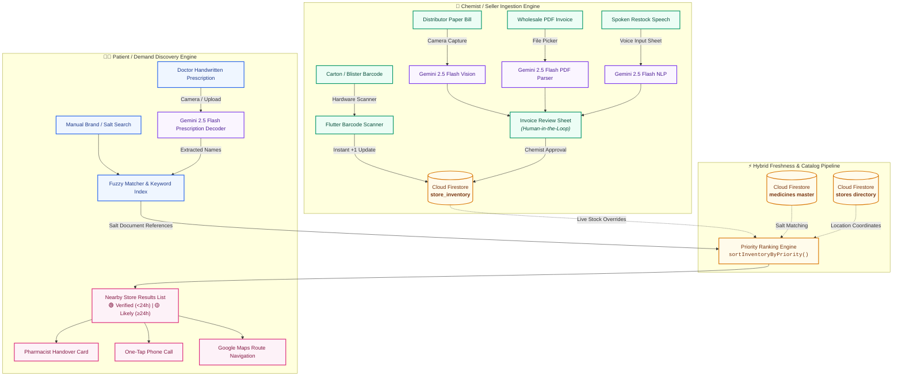
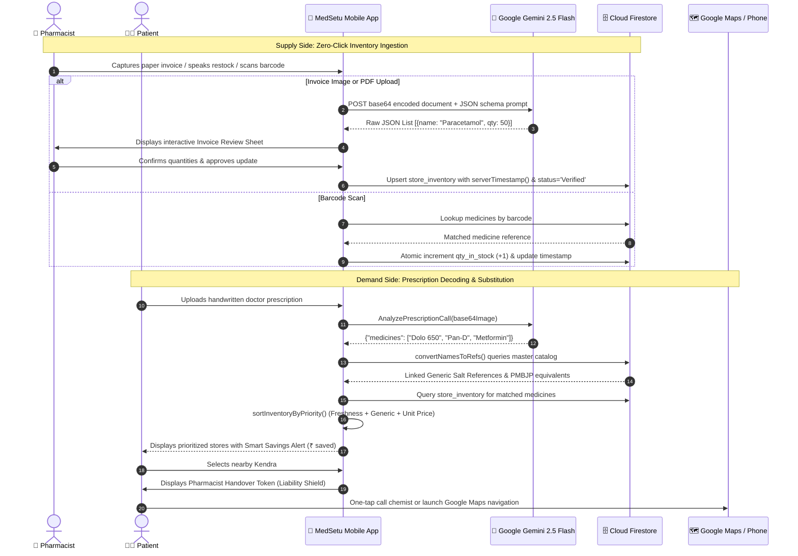

<div align="center">

  

  # 💊 MedSetu (जन सेतु)
  ### *Bridging the gap between doctor handwriting, affordable generic medicines, and real-time pharmacy inventory.*

  **Built for the GDG VESIT TechSprint Hackathon**  
  **Crafted by [Parth Chavan](https://github.com/Parth-Chavan-15)**

  <p align="center">
    <a href="https://flutter.dev"></a>
    <a href="https://dart.dev"></a>
    <a href="https://ai.google.dev"></a>
    <a href="https://firebase.google.com"></a>
    <a href="https://developers.google.com/maps"></a>
    <a href="LICENSE"></a>
  </p>

  <p align="center">
    <strong>MedSetu</strong> is a <b>Dual-Agent Healthcare Ecosystem</b> engineered to fix the critical "last-mile" failure of the <i>Pradhan Mantri Bhartiya Janaushadhi Pariyojana (PMBJP)</i>. It combines <b>zero-friction multimodal inventory ingestion</b> for local chemists with a <b>visual prescription AI decoder</b>, <b>bio-equivalent generic salt routing</b>, and <b>dynamic freshness verification</b> for patients.
  </p>

  <p align="center">
    <a href="#-the-problem-the-ghost-stock-reality">The Problem</a> •
    <a href="#-the-medsetu-dual-agent-solution">The Solution</a> •
    <a href="#-key-highlights">Key Features</a> •
    <a href="#-system-architecture">Architecture</a> •
    <a href="#-algorithmic-intelligence-priority-ranking">Ranking Engine</a> •
    <a href="#-medical-liability--safety-protocols">Safety Protocols</a> •
    <a href="#-firestore-database-schema">Data Model</a> •
    <a href="#-quick-start">Quick Start</a>
  </p>

</div>

---

## 🚨 The Problem: The "Ghost Stock" Reality

Under the Government of India’s **Pradhan Mantri Bhartiya Janaushadhi Pariyojana (PMBJP)**, authorized Kendras provide high-quality generic medicines at **50% to 90% cheaper rates** than commercial brands.

Despite this initiative, millions of citizens still buy costly branded drugs out-of-pocket due to three persistent bottlenecks:

```
[Messy Doctor Prescription] ────❌ Illegible Brand Names────► [Patient (Unaware of Generic Salt)]
                                                                           │
                                                                   Travels Across Town
                                                                           ▼
[Central Database: "In Stock"] ──❌ Out of Sync with Shelves──► [Physical Store: "Ghost Stock" (Empty)]
```

1. **The "Ghost Stock" Paradox**: Government catalogs assume stores carry mandatory inventories. In reality, local pharmacy owners do not have the time or tools for cumbersome manual database entry. Shelves run out, while central directories report false availability.
2. **The Handwriting & Salt-Name Barrier**: Prescriptions are written in doctor shorthand with commercial brand names (e.g., *Augmentin 625*, *Dolo 650*). Patients have no easy way to translate them into generic chemical formulations (e.g., *Amoxicillin + Clavulanic Acid*, *Paracetamol 650mg*).
3. **Wasted Journeys & Medical Compromise**: Patients travel miles to a Jan Aushadhi Kendra, only to discover the medicine is out of stock. Frustrated, they walk into a nearby commercial chemist and pay standard market prices.

---

## 💡 The MedSetu Dual-Agent Solution

MedSetu flips the paradigm from **passive central directories** to an **AI-powered Real-Time Data Pipeline**:

| Challenge | Traditional Approach | The MedSetu Dual-Agent Pipeline |
| :--- | :--- | :--- |
| **Inventory Logging** | Manual typing into legacy desktop ERPs (rarely done). | **Zero-Click Multimodal Supply**: Camera invoice OCR, wholesale PDF parsing, voice dictation, and barcode scanning. |
| **Prescription Reading** | Patients struggle to read shorthand brand names. | **Multimodal Vision OCR**: Gemini extracts medicine names directly from handwriting and matches generic salts. |
| **Stock Accuracy** | Unverified catalog assumptions ("Ghost Stock"). | **Two-Tier Freshness Engine**: Distinguishes 🟢 **Verified Stock (<24h)** from 🟡 **Likely Stock (≥24h)**. |
| **Dispensation Safety** | Unregulated app suggestions. | **Pharmacist Handshake**: Dynamic in-app verification token shifting substitution authority to licensed chemists. |

---

## ✨ Key Highlights

### 🏪 1. The Chemist Agent (Zero-Click Data Supply)
Designed for busy pharmacy operators who have zero time for manual inventory logging.

* **📸 Paper Invoice OCR Ingestion**: Snap a photo of a wholesale distributor's paper bill. Google Gemini 2.5 Flash Vision parses tabular rows into structured JSON (`name`, `qty`) in seconds.
* **📄 Wholesale PDF Ingestion**: Directly upload digital distributor invoices (`.pdf`). Gemini extracts full medicine batches and quantities in a single tap.
* **🎙️ Voice-to-Ledger Dictation**: Tap the microphone and speak naturally (e.g., *"Received 50 strips of Metformin 500mg and 20 bottles of Cetirizine"*). The NLP engine parses quantities and automatically corrects Indian pharmaceutical phonetic spellings.
* **📦 Rapid Barcode Restocking**: Integrated camera barcode scanner (`flutter_barcode_scanner`) scans blister packs and medicine cartons, executing instant atomic `+1` inventory increments in Cloud Firestore.
* **🧑‍💻 Human-in-the-Loop Review Sheet**: Prevents AI hallucinations from polluting records. Shopkeepers review, edit, or delete items on an interactive bottom sheet before committing updates to the live database.

---

### 🧑‍🦳 2. The Patient Agent (Intelligent Demand & Discovery)
Engineered for citizens and elderly patients who need fast, affordable generic substitutions.

* **👁️ Handwritten Prescription Decoder**: Upload a photo of a doctor's prescription. Gemini Vision OCR identifies brand and generic medications while filtering out handwriting artifacts, frequencies, and dosage noise.
* **🔄 Automatic Salt Substitution & Price Comparison**: Cross-references prescribed brands against bio-equivalent Jan Aushadhi generic alternatives, showing transparent side-by-side price savings in ₹.
* **🟢 Verified (<24h) vs. 🟡 Likely In-Stock Indicators**:
  * 🟢 **Verified In-Stock**: Chemist restocked or verified the item via OCR, voice, or barcode within the last 24 hours.
  * 🟡 **Likely In-Stock**: Baseline PMBJP catalog entry without recent chemist confirmation.
* **🤝 The "Pharmacist Card" (Liability Shield)**: An in-app handover screen designed for counter presentation:
  > *"Hello Pharmacist, please verify if [Generic Salt] is a valid substitute for [Prescribed Brand] prescribed here."*
* **🗺️ Integrated Direction Preview & Direct Dialing**: Embedded route preview with one-tap deep links to native Google Maps navigation and direct phone calls to the chemist.

---

## 🏗️ System Architecture



<details>
<summary><b>🔍 Click to expand detailed System Sequence Workflow</b></summary>



</details>

---

## ⚡ Algorithmic Intelligence: Priority Ranking

To eradicate ghost stock, MedSetu implements a **hybrid prioritization algorithm** (`sortInventoryByPriority`) that scores and sorts available stores based on physical data freshness:

$$\text{Store Priority Score} = \Big(100 \times \mathbb{I}_{(\Delta t < 24\text{h})}\Big) + \Big(10 \times \mathbb{I}_{(\text{isGeneric} = \text{true})}\Big)$$

$$\text{Tie-Breaker: } \min(\text{unit\_price})$$

```dart
List<StoreInventoryRecord> sortInventoryByPriority(List<StoreInventoryRecord> inputList) {
  final now = DateTime.now();

  inputList.sort((a, b) {
    final bool aFresh = now.difference(a.lastUpdated ?? DateTime(1970)).inHours < 24;
    final bool bFresh = now.difference(b.lastUpdated ?? DateTime(1970)).inHours < 24;

    int scoreA = 0;
    int scoreB = 0;

    // 1. Freshness Tier (< 24 hours): +100 pts (Guarantee zero ghost-stock trips)
    if (aFresh) scoreA += 100;
    if (bFresh) scoreB += 100;

    // 2. Generic Preference: +10 pts (PMBJP Kendra prioritization)
    if (a.isGeneric == true) scoreA += 10;
    if (b.isGeneric == true) scoreB += 10;

    // 3. Score Evaluation
    if (scoreA != scoreB) {
      return scoreB.compareTo(scoreA); // Highest score first
    }

    // 4. Tie-Breaker: Lowest Unit Price First
    final double aPrice = (a.unitPrice ?? 999999).toDouble();
    final double bPrice = (b.unitPrice ?? 999999).toDouble();
    return aPrice.compareTo(bPrice);
  });

  return inputList;
}
```

### Visual Freshness Indicators (`getStatusColor`)

| Badge | Status | Condition | Meaning |
| :---: | :--- | :--- | :--- |
|  `🟢` | **Verified In-Stock** | Last updated `< 24 hours` | Physical stock confirmed via invoice OCR, voice, or barcode today. Zero ghost-stock risk. |
|  `🟡` | **Likely In-Stock** | Last updated `≥ 24 hours` or catalog default | Expected PMBJP baseline stock; patient is advised to call before visiting. |

---

## 🛡️ Medical Liability & Safety Protocols

> [!IMPORTANT]
> **MedSetu is an informational bridge, not a prescribing medical entity.**  
> Indian pharmaceutical regulations strictly require prescription-only medicines (Schedule H/H1) to be dispensed under the direct supervision of a registered pharmacist.

MedSetu implements **three defense-in-depth safety layers**:

```
┌─────────────────────────────────────────────────────────────────────────┐
│                       3-TIER MEDICAL SAFETY MATRIX                      │
├───────────────────────────┬─────────────────────────────────────────────┤
│ 1. Mandatory Gate Modal   │ Explicit user disclaimer on first launch    │
│                           │ acknowledging pharmacist confirmation.       │
├───────────────────────────┼─────────────────────────────────────────────┤
│ 2. The Pharmacist Card    │ In-app counter token presenting substitute   │
│                           │ generic salt for licensed pharmacist check. │
├───────────────────────────┼─────────────────────────────────────────────┤
│ 3. Human-in-the-Loop OCR  │ Prevents raw AI vision extraction from      │
│                           │ corrupting stock without chemist sign-off.   │
└───────────────────────────┴─────────────────────────────────────────────┘
```

1. **Mandatory Launch Disclaimer**: Users must explicitly acknowledge:  
   `"Always verify medicines with a registered Pharmacist before purchase."`
2. **The Counter Handshake Card**: Before navigation, the app provides a designated handover token for the chemist:  
   `"Hello Pharmacist, please verify if [Generic Salt] is a valid substitute for [Prescribed Brand] prescribed here."`
3. **Chemist Review Gate**: OCR and Voice extractions are never written directly to Firestore; they populate an interactive editable sheet requiring human validation.

---

## 🗄️ Firestore Database Schema

<details open>
<summary><b>📂 Click to expand / collapse Database Schema details</b></summary>

### 1. `medicines` Collection
Master catalog linking commercial brand names to generic formulations.

| Field Name | Type | Description | Example |
| :--- | :--- | :--- | :--- |
| `brand_name` | `String` | Commercial pharmaceutical brand name | `"Dolo 650"` |
| `generic_name` | `String` | Bio-equivalent active chemical formulation | `"Paracetamol 650mg"` |
| `is_generic` | `Boolean` | Flag indicating government generic formulation | `true` |
| `generic_source_ref` | `DocumentReference` | Reference to parent generic salt document | `/medicines/generic_pcm` |
| `std_price` | `Double` | Standard open-market MRP | `32.0` |
| `barcode` | `String` | EAN / UPC package identifier | `"8901234567890"` |
| `search_keywords` | `String` | Normalized string for prefix & substring search | `"dolo paracetamol 650"` |

---

### 2. `stores` Collection
Registered pharmacies and Jan Aushadhi Kendras.

| Field Name | Type | Description | Example |
| :--- | :--- | :--- | :--- |
| `store_name` | `String` | Name of the pharmacy or Kendra | `"Pradhan Mantri Jan Aushadhi Kendra #104"` |
| `owner_uid` | `String` | Firebase Auth UID of the verified shopkeeper | `"uid_chemist_abc123"` |
| `license_number` | `String` | State Drug Authority pharmacy license number | `"DL-MH-102938"` |
| `phone_number` | `String` | Contact number for one-tap patient calling | `"+919876543210"` |
| `location` | `LatLng` | Geographic coordinates for distance & routing | `19.0760, 72.8777` |
| `is_generic_store` | `Boolean` | True if authorized PMBJP outlet | `true` |
| `created_at` | `DateTime` | Store profile creation timestamp | `2026-01-14T18:00:00Z` |

---

### 3. `store_inventory` Collection
The real-time link between physical pharmacy branches and medicine availability.

| Field Name | Type | Description | Example |
| :--- | :--- | :--- | :--- |
| `store_ref` | `DocumentReference` | Pointer to the parent `stores` document | `/stores/kendra_104` |
| `medicine_id` | `DocumentReference` | Pointer to the `medicines` catalog document | `/medicines/dolo_650` |
| `qty_in_stock` | `Integer` | Verified physical unit quantity on shelves | `45` |
| `unit_price` | `Double` | Store-level selling price (₹) | `6.50` |
| `status` | `String` | Verification status (`"Verified"` vs `"Likely"`) | `"Verified"` |
| `is_generic` | `Boolean` | Cached generic flag for low-cost ranking | `true` |
| `last_updated` | `DateTime` | Timestamp used for the `< 24h` freshness check | Server Timestamp |

---

### 4. `users` Collection
User profiles for shopkeepers and patients.

| Field Name | Type | Description | Example |
| :--- | :--- | :--- | :--- |
| `uid` | `String` | Firebase Authentication UID | `"auth_usr_9988"` |
| `display_name` | `String` | Full name of user or pharmacist | `"Parth Chavan"` |
| `email` | `String` | Primary account email address | `"parth@example.com"` |
| `phone_number` | `String` | Registered mobile contact | `"+919876543210"` |
| `created_time` | `DateTime` | Account registration timestamp | `2026-01-14T12:00:00Z` |

</details>

---

## 🛠️ Tech Stack & Dependencies

```
┌─────────────────────────────────────────────────────────────────────────┐
│                           MEDSETU TECH STACK                            │
├───────────────────────┬─────────────────────────────────────────────────┤
│ Core Framework        │ Flutter 3.x (Dart 3.x)                          │
├───────────────────────┼─────────────────────────────────────────────────┤
│ UI & State Management │ FlutterFlow, Provider, Google Fonts (Poppins,   │
│                       │ Inter), Flutter Animate                         │
├───────────────────────┼─────────────────────────────────────────────────┤
│ AI & Multimodal Vision│ Google Gemini 2.5 Flash API                     │
│                       │ (google_generative_ai, custom REST pipelines)   │
├───────────────────────┼─────────────────────────────────────────────────┤
│ Backend & Database    │ Google Cloud Firestore, Firebase Storage        │
├───────────────────────┼─────────────────────────────────────────────────┤
│ Authentication        │ Firebase Auth (Email/Password, Phone OTP)       │
├───────────────────────┼─────────────────────────────────────────────────┤
│ Hardware & Scanning   │ flutter_barcode_scanner, image_picker,          │
│                       │ file_picker (PDF wholesale bills)               │
├───────────────────────┼─────────────────────────────────────────────────┤
│ Geo & Communication   │ geolocator, Google Maps API, url_launcher       │
└───────────────────────┴─────────────────────────────────────────────────┘
```

---

## 🚦 Quick Start

Follow these steps to run MedSetu locally on your development machine.

### 1. Prerequisites
Ensure you have the following installed:
* [Flutter SDK](https://docs.flutter.dev/get-started/install) (`>= 3.0.0 < 4.0.0`)
* [Dart SDK](https://dart.dev/get-dart) (`>= 3.0.0`)
* Android Studio (with Android SDK & Emulator) or Xcode (macOS)
* A [Firebase Project](https://console.firebase.google.com/) with Firestore & Authentication enabled
* A [Google AI Studio API Key](https://aistudio.google.com/) for Gemini 2.5 Flash

### 2. Clone the Repository
```bash
git clone https://github.com/Parth-Chavan-15/MedSetu-TechSprint.git
cd MedSetu-TechSprint
```

### 3. Configure Firebase
Download and place the platform configuration files into the project:
* **Android**: Download `google-services.json` from Firebase Console and place it at:
  ```
  android/app/google-services.json
  ```
* **iOS** (if building for Apple platforms): Download `GoogleService-Info.plist` and place it at:
  ```
  ios/Runner/GoogleService-Info.plist
  ```

### 4. Configure API Keys
The multimodal vision pipelines call Google Gemini 2.5 Flash. Ensure your Gemini API key is configured in `lib/backend/gemini/gemini.dart` and `lib/backend/api_requests/api_calls.dart` or injected via environment variables:

```bash
# Verify API connection using the built-in test suite
flutter pub get
```

> [!TIP]
> To configure location simulation on Android Emulators:
> Open Emulator Extended Controls (`...`) &rarr; **Location** &rarr; Set Latitude: `19.0760`, Longitude: `72.8777` (Mumbai) to test proximity routing with seed stores.

### 5. Install Dependencies & Launch
```bash
# Clean cached packages
flutter clean

# Fetch all pub packages
flutter pub get

# Run on connected physical device or emulator
flutter run

# Or run on Chrome Web
flutter run -d chrome
```

---

## 🧭 Application Navigation Flow

```
                           ┌────────────────────────────┐
                           │      MedSetu Welcome       │
                           │        (Role Gate)         │
                           └──────────────┬─────────────┘
                                          │
                ┌─────────────────────────┴─────────────────────────┐
                ▼                                                   ▼
     ┌──────────────────────┐                            ┌──────────────────────┐
     │   🧑‍🦳 Patient / User   │                            │  🏪 Pharmacy Owner   │
     └──────────┬───────────┘                            └──────────┬───────────┘
                │                                                   │
        [Disclaimer Dialog]                                   [Store Gate]
                │                                        (Login / Registration)
                ▼                                                   │
     ┌──────────────────────┐                                       ▼
     │ Patient Search Hub   │                            ┌──────────────────────┐
     │ • Rx Camera Capture  │                            │   Seller Dashboard   │
     │ • Text Keyword Search│                            │ • Today's Statistics │
     └──────────┬───────────┘                            │ • Inventory Overview │
                │                                        └──────────┬───────────┘
                ▼                                                   │
     ┌──────────────────────┐                            4 Ingestion Modalities:
     │ Store Results Screen │                            ├── 1. Invoice Photo OCR
     │ • Freshness Sorting  │                            ├── 2. Wholesale PDF Ingestion
     │ • Smart Price Savings│                            ├── 3. Carton Barcode Scan
     └──────────┬───────────┘                            └── 4. Natural Voice Restock
                │                                                   │
                ▼                                                   ▼
     ┌──────────────────────┐                            ┌──────────────────────┐
     │ Store Navigator Hub  │                            │ Invoice Review Sheet │
     │ • Pharmacist Handover│                            │ (Human-in-the-Loop)  │
     │ • Direct Dial Chemist│                            └──────────┬───────────┘
     │ • Google Maps Route  │                                       │
     └──────────────────────┘                                       ▼
                                                        [Cloud Firestore Sync]
```

---

## 🏆 Project Context

* **Event**: GDG VESIT TechSprint Hackathon
* **Domain**: Healthcare Accessibility, Multimodal AI, and Public Health Logistics
* **Mission**: Ending out-of-pocket medical expenditure by bringing real-time supply transparency to India's *Pradhan Mantri Bhartiya Janaushadhi Pariyojana (PMBJP)*.

---

## 👨‍💻 Author

**Parth Chavan**
* GitHub: [@Parth-Chavan-15](https://github.com/Parth-Chavan-15)
* Repository: [MedSetu-TechSprint](https://github.com/Parth-Chavan-15/MedSetu-TechSprint)

---

<div align="center">
  <sub>Built with ❤️ by Parth Chavan to make affordable healthcare a reality for every Indian citizen. 🇮🇳</sub>
</div>
