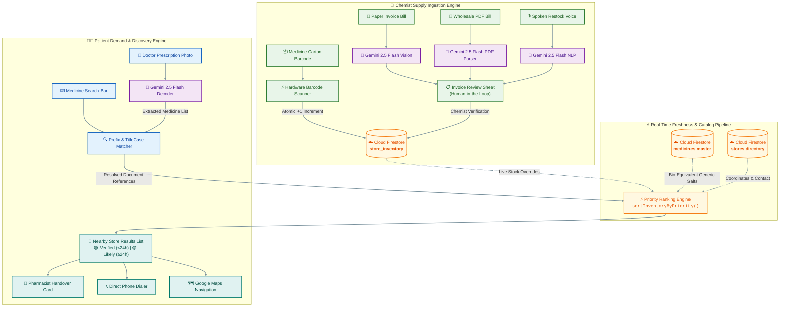
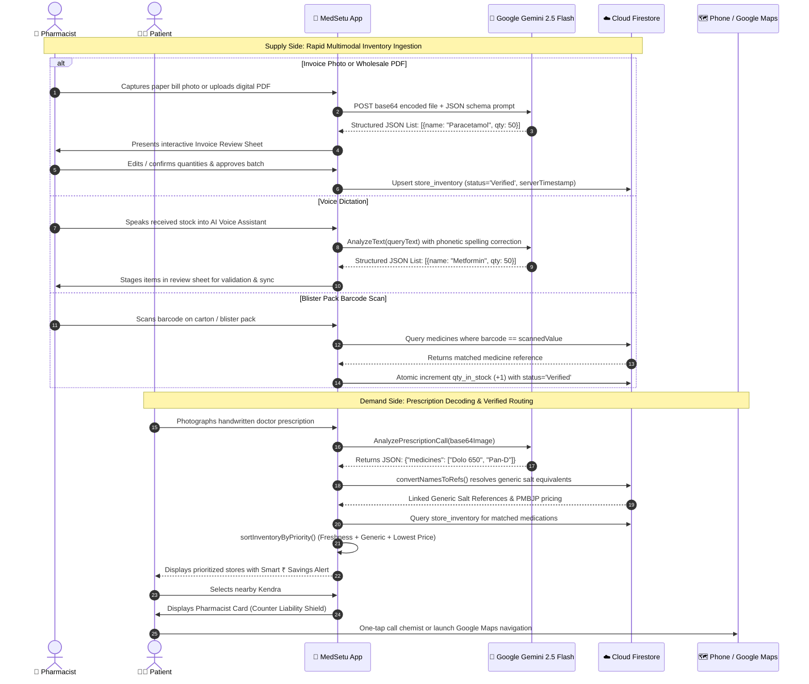
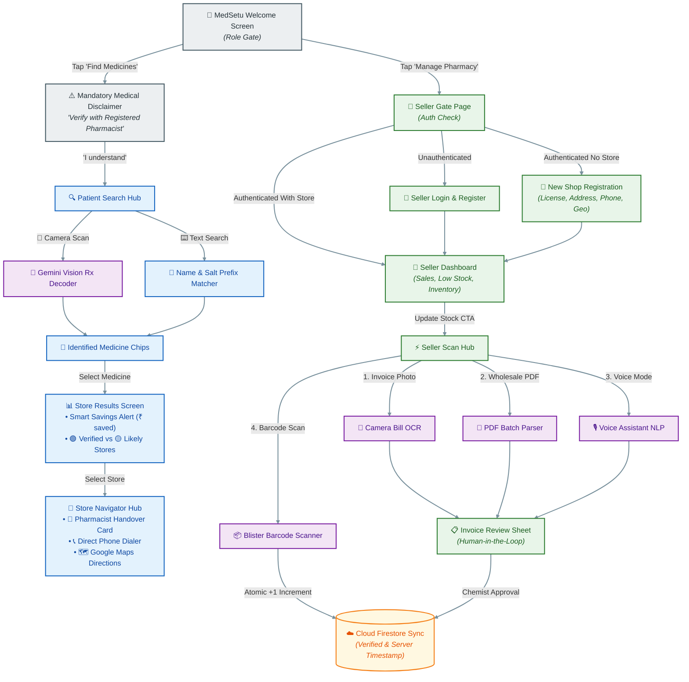

<div align="center">

  

  # 💊 MedSetu (जन सेतु)
  ### *Bridging the gap between doctor handwriting, affordable generic medicines, and real-time pharmacy inventory.*

  **Built for the GDG VESIT TechSprint Hackathon**  
  **Crafted by [Parth Chavan](https://github.com/Parth-Chavan-15)**

  <p align="center">
    <a href="https://flutter.dev"></a>
    <a href="https://dart.dev"></a>
    <a href="https://ai.google.dev"></a>
    <a href="https://firebase.google.com"></a>
    <a href="https://developers.google.com/maps"></a>
  </p>

  <p align="center">
    <strong>MedSetu</strong> is a <b>Dual-Agent Healthcare Ecosystem</b> engineered to fix the critical "last-mile" failure of the <i>Pradhan Mantri Bhartiya Janaushadhi Pariyojana (PMBJP)</i>. It combines <b>zero-friction multimodal inventory ingestion</b> for local chemists with a <b>visual prescription AI decoder</b>, <b>bio-equivalent generic salt routing</b>, and <b>dynamic freshness verification</b> for patients.
  </p>

  <p align="center">
    <a href="#-the-problem-the-ghost-stock-reality">The Problem</a> •
    <a href="#-the-medsetu-dual-agent-solution">The Solution</a> •
    <a href="#-key-highlights">Key Features</a> •
    <a href="#-system-architecture">Architecture</a> •
    <a href="#-algorithmic-intelligence-priority-ranking">Ranking Engine</a> •
    <a href="#-medical-liability--safety-protocols">Safety Protocols</a> •
    <a href="#-firestore-database-schema">Data Model</a> •
    <a href="#-quick-start">Quick Start</a> •
    <a href="#-application-navigation-flow">Navigation Flow</a>
  </p>

</div>

---

## 🚨 The Problem: The "Ghost Stock" Reality

Under the Government of India’s **Pradhan Mantri Bhartiya Janaushadhi Pariyojana (PMBJP)**, authorized Kendras provide high-quality generic medicines at **50% to 90% cheaper rates** than commercial brands.

Despite this nationwide initiative, millions of citizens continue to pay high out-of-pocket costs for expensive branded drugs due to three compounding real-world bottlenecks:

```
[Messy Doctor Prescription] ────❌ Illegible Brand Names────► [Patient (Unaware of Generic Salt)]
                                                                           │
                                                                   Travels Across Town
                                                                           ▼
[Central Database: "In Stock"] ──❌ Out of Sync with Shelves──► [Physical Store: "Ghost Stock" (Empty)]
```

1. **The "Ghost Stock" Paradox**: Central government catalogs assume Kendras carry mandatory inventory quotas. In reality, local pharmacy owners lack the time and tooling for tedious manual database updates into legacy desktop ERPs. Physical shelves run dry, while central directories falsely report medicines as available.
2. **The Handwriting & Salt-Name Barrier**: Prescriptions are written in rapid doctor shorthand using commercial brand names (e.g., *Augmentin 625*, *Dolo 650*, *Pan-D*). Patients have no accessible way to decode these into active bio-equivalent chemical formulations (e.g., *Amoxicillin + Clavulanic Acid*, *Paracetamol 650mg*).
3. **Frustrating Wasted Journeys**: Patients travel across town to Jan Aushadhi stores only to find medicines out of stock. Disheartened and in urgent need, they turn to nearby commercial chemists and pay full retail market prices out-of-pocket.

---

## 💡 The MedSetu Dual-Agent Solution

MedSetu flips the paradigm from **passive central directories** to an **AI-driven Real-Time Data Supply Pipeline**:

| Challenge | Traditional Approach | The MedSetu Dual-Agent Pipeline |
| :--- | :--- | :--- |
| **Inventory Ingestion** | Tedious manual entry into desktop software (rarely done). | **Zero-Click Multimodal Supply**: Camera invoice OCR, wholesale PDF parsing, voice dictation, and barcode scanning. |
| **Prescription Reading** | Patients struggle to read doctor handwriting & brand names. | **Multimodal Vision OCR**: Gemini 2.5 Flash extracts medicine names directly from handwriting and matches generic salts. |
| **Stock Accuracy** | Unverified catalog assumptions ("Ghost Stock"). | **Two-Tier Freshness Engine**: Distinguishes 🟢 **Verified Stock (<24h)** from 🟡 **Likely Stock (≥24h)**. |
| **Price Transparency** | Patients remain unaware of affordable alternatives. | **Smart ₹ Savings Engine**: Automatic calculation of direct cost savings when switching to bio-equivalent generics. |
| **Dispensation Safety** | Unregulated app suggestions create legal risks. | **3-Tier Medical Safety Matrix**: Mandatory launch disclaimer, human review sheet, and counter **Pharmacist Handover Card**. |

---

## ✨ Key Highlights

### 🏪 1. The Chemist Agent (Zero-Click Multimodal Ingestion)
Designed for busy local pharmacists and Jan Aushadhi Kendra operators who have zero time for manual inventory logging.

* **📸 Paper Invoice OCR Ingestion**: Snap a photo of a distributor paper bill. Google Gemini 2.5 Flash Vision parses tabular rows into structured JSON (`name`, `qty`) in seconds.
* **📄 Wholesale PDF Ingestion**: Directly upload digital distributor invoices (`.pdf`). Gemini extracts full medicine batches and quantities in a single tap without manual typing.
* **🎙️ Voice-to-Ledger Dictation**: Tap the microphone and speak naturally (e.g., *"Received 50 strips of Metformin 500mg and 20 bottles of Cetirizine"*). The NLP engine parses quantities and automatically corrects Indian pharmaceutical phonetic spellings.
* **📦 High-Speed Barcode Restocking**: Integrated camera barcode scanner (`flutter_barcode_scanner`) scans blister packs and cartons, executing atomic `+1` inventory increments in Cloud Firestore with instant haptic and toast confirmation.
* **🧑‍💻 Human-in-the-Loop Review Sheet**: Prevents AI extraction inaccuracies from polluting production records. Shopkeepers review, edit quantities, and delete items on an interactive bottom sheet before committing updates to the live database.

---

### 🧑‍🦳 2. The Patient Agent (Intelligent Demand & Safe Discovery)
Engineered for citizens, elderly patients, and caregivers who need fast, affordable generic substitutions.

* **👁️ Handwritten Prescription Decoder**: Upload a camera photo of a doctor's prescription. Gemini Vision OCR identifies brand and generic medications while filtering out handwriting noise, frequencies (e.g., 1-0-1), and dosage notes.
* **🔄 Automatic Salt Substitution & Price Comparison**: Cross-references prescribed brands against bio-equivalent Jan Aushadhi generic alternatives, showing transparent side-by-side price savings in ₹.
* **🟢 Two-Tier Freshness Engine (Verified vs. Likely Stock)**:
  * 🟢 **Verified In-Stock (<24h)**: Chemist restocked or verified the item via invoice OCR, PDF, voice, or barcode within the last 24 hours. Zero ghost-stock risk.
  * 🟡 **Likely In-Stock (≥24h)**: Baseline catalog entry without recent chemist confirmation. Patient is advised to call ahead.
* **🤝 The Pharmacist Card (Liability Shield)**: An in-app handover screen designed for counter presentation:
  > *"Hello Pharmacist, please verify if [Generic Salt] is a valid substitute for [Prescribed Brand] prescribed here."*
* **🗺️ Integrated Proximity Navigation & Direct Calling**: Embedded store preview with one-tap deep links to native Google Maps navigation and direct phone calls to the chemist.

---

## 🏗️ System Architecture



<div align="center">
  <sub>Dual-agent architecture: supply-side rapid multimodal ingestion meets demand-side prescription decoding and freshness-based pharmacy ranking.</sub>
</div>

<details>
<summary><b>🔍 View detailed End-to-End Sequence Diagram (click to expand)</b></summary>



</details>

---

## ⚡ Algorithmic Intelligence: Priority Ranking

To eliminate ghost stock, MedSetu implements a **hybrid prioritization algorithm** (`sortInventoryByPriority`) that scores and ranks pharmacies based on physical data freshness, generic availability, and unit price:

$$\text{Store Priority Score} = \Big(100 \times \mathbb{I}_{(\Delta t < 24\text{h})}\Big) + \Big(10 \times \mathbb{I}_{(\text{isGeneric} = \text{true})}\Big)$$

$$\text{Tie-Breaker: } \min(\text{unit\_price})$$

```dart
List<StoreInventoryRecord> sortInventoryByPriority(List<StoreInventoryRecord> inputList) {
  final now = DateTime.now();

  inputList.sort((a, b) {
    // 1. Determine Freshness (< 24 hours)
    final DateTime aTime = a.lastUpdated ?? DateTime(1970);
    final DateTime bTime = b.lastUpdated ?? DateTime(1970);
    final bool aFresh = now.difference(aTime).inHours < 24;
    final bool bFresh = now.difference(bTime).inHours < 24;

    // 2. Generic Preference
    final bool aGeneric = a.isGeneric == true;
    final bool bGeneric = b.isGeneric == true;

    // Convert unit prices safely
    final double aPrice = (a.unitPrice ?? 999999).toDouble();
    final double bPrice = (b.unitPrice ?? 999999).toDouble();

    int scoreA = 0;
    int scoreB = 0;

    // Freshness Tier (< 24 hours): +100 pts (Guarantee zero ghost-stock trips)
    if (aFresh) scoreA += 100;
    if (bFresh) scoreB += 100;

    // Generic Priority: +10 pts (Prioritize PMBJP Kendra generics)
    if (aGeneric) scoreA += 10;
    if (bGeneric) scoreB += 10;

    // Compare Scores
    if (scoreA != scoreB) {
      return scoreB.compareTo(scoreA); // Highest score first
    }

    // Tie-Breaker: Lowest Unit Price First
    return aPrice.compareTo(bPrice);
  });

  return inputList;
}
```

### Visual Freshness Indicators (`getStatusColor`)

| Indicator | Status | Verification Condition | Real-World Operational Meaning |
| :---: | :--- | :--- | :--- |
| `🟢` | **Verified In-Stock** | Last updated `< 24 hours` (`Color(0xFF4CAF50)`) | Stock confirmed today via camera invoice OCR, wholesale PDF, voice, or barcode. Zero ghost-stock risk. |
| `🟡` | **Likely In-Stock** | Last updated `≥ 24 hours` or catalog default (`Color(0xFFFFC107)`) | Baseline government catalog listing without recent chemist verification. Patient is advised to call ahead. |

---

## 🛡️ Medical Liability & Safety Protocols

> [!IMPORTANT]
> **MedSetu is an informational bridge, not a prescribing authority.**  
> Indian pharmaceutical regulations (Drugs and Cosmetics Act) strictly mandate that prescription-only medicines (Schedule H/H1) be dispensed exclusively under the direct supervision of a registered pharmacist.

MedSetu implements a **3-Tier Medical Safety Matrix** to protect patients, pharmacies, and platforms:

```
┌──────────────────────────────────────────────────────────────────────────┐
│                       3-TIER MEDICAL SAFETY MATRIX                       │
├───────────────────────────┬──────────────────────────────────────────────┤
│ 1. Mandatory Gate Modal   │ Explicit user disclaimer on first launch     │
│                           │ acknowledging pharmacist confirmation.       │
├───────────────────────────┼──────────────────────────────────────────────┤
│ 2. The Pharmacist Card    │ In-app counter token presenting substitute   │
│                           │ generic salt for licensed pharmacist check.  │
├───────────────────────────┼──────────────────────────────────────────────┤
│ 3. Human-in-the-Loop OCR  │ Prevents raw AI vision extraction from       │
│                           │ corrupting stock without chemist sign-off.    │
└───────────────────────────┴──────────────────────────────────────────────┘
```

1. **Mandatory Launch Disclaimer**: Users must explicitly acknowledge:  
   `"Always verify medicines with a registered Pharmacist before purchase."`
2. **The Counter Handshake Card**: Before navigation, the app provides a designated handover token for the chemist:  
   `"Hello Pharmacist, please verify if [Generic Salt] is a valid substitute for [Prescribed Brand] prescribed here."`
3. **Chemist Review Gate**: OCR and Voice extractions are never written directly to Firestore; they populate an interactive editable sheet requiring human validation.

---

## 🗄️ Firestore Database Schema

The database model is architected around four core collections in Cloud Firestore:

### 1. `medicines` Collection
Master pharmaceutical catalog linking commercial brands to active generic chemical formulations.

| Field Name | Type | Description | Example |
| :--- | :--- | :--- | :--- |
| `brand_name` | `String` | Commercial pharmaceutical brand name | `"Dolo 650"` |
| `generic_name` | `String` | Bio-equivalent active chemical formulation | `"Paracetamol 650mg"` |
| `is_generic` | `Boolean` | True if authorized government generic salt | `true` |
| `generic_source_ref` | `DocumentReference` | Pointer to the parent generic salt record | `/medicines/generic_pcm_650` |
| `std_price` | `Double` | Standard open-market MRP (₹) | `32.0` |
| `barcode` | `String` | EAN / UPC package identifier | `"8901234567890"` |
| `search_keywords` | `String` | Normalized string for prefix and substring matching | `"dolo paracetamol 650"` |

---

### 2. `stores` Collection
Registered pharmacies and authorized Jan Aushadhi Kendras.

| Field Name | Type | Description | Example |
| :--- | :--- | :--- | :--- |
| `store_name` | `String` | Registered pharmacy or Kendra outlet name | `"Pradhan Mantri Jan Aushadhi Kendra #104"` |
| `owner_uid` | `String` | Firebase Authentication UID of the verified chemist | `"usr_chemist_abc123"` |
| `license_number` | `String` | State Drug Authority pharmacy license number | `"DL-MH-102938"` |
| `phone_number` | `String` | Contact number for one-tap patient calling | `"+919876543210"` |
| `location` | `LatLng` | Geographic coordinates for proximity calculation | `19.0760, 72.8777` |
| `is_generic_store` | `Boolean` | True if official PMBJP generic outlet | `true` |
| `created_at` | `DateTime` | Store profile creation timestamp | `2026-01-14T18:00:00Z` |

---

### 3. `store_inventory` Collection
The real-time link connecting physical pharmacy branches to active medicine stock and freshness timestamps.

| Field Name | Type | Description | Example |
| :--- | :--- | :--- | :--- |
| `store_ref` | `DocumentReference` | Reference to the parent `stores` document | `/stores/kendra_104` |
| `medicine_id` | `DocumentReference` | Reference to the `medicines` catalog item | `/medicines/generic_pcm_650` |
| `qty_in_stock` | `Integer` | Physical unit quantity on shelves | `45` |
| `unit_price` | `Double` | Store-level selling price (₹) | `6.50` |
| `status` | `String` | Verification status (`"Verified"` vs `"Likely"`) | `"Verified"` |
| `is_generic` | `Boolean` | Cached generic flag for rapid priority sorting | `true` |
| `last_updated` | `DateTime` | Server timestamp used for the `< 24h` freshness check | Server Timestamp |

---

### 4. `users` Collection
User profiles for shopkeepers and patients.

| Field Name | Type | Description | Example |
| :--- | :--- | :--- | :--- |
| `uid` | `String` | Firebase Authentication UID | `"auth_usr_9988"` |
| `display_name` | `String` | Full name of user or pharmacist | `"Parth Chavan"` |
| `email` | `String` | Primary account email address | `"parth@example.com"` |
| `phone_number` | `String` | Registered mobile contact | `"+919876543210"` |
| `created_time` | `DateTime` | Account registration timestamp | `2026-01-14T12:00:00Z` |

---

## 🚦 Quick Start

Follow these steps to run MedSetu locally on your development machine or mobile device.

### 1. Prerequisites
Ensure you have the following installed with versions matching the repository requirements:
* **Flutter SDK**: `3.x` (Dart SDK `>= 3.0.0 < 4.0.0` from [flutter.dev](https://docs.flutter.dev/get-started/install))
* **Android SDK**: Compile SDK `35`, Min SDK `23`, Target SDK `35` (via Android Studio) or Xcode for iOS
* **Firebase Project**: A Firebase project with Firestore, Authentication, and Storage enabled
* **Google AI Studio API Key**: An API key for Google Gemini 2.5 Flash from [Google AI Studio](https://aistudio.google.com/)

### 2. Clone the Repository
```bash
git clone https://github.com/Parth-Chavan-15/MedSetu-TechSprint.git
cd MedSetu-TechSprint
```

### 3. Configure Firebase
Download and place the platform-specific configuration files into the project:
* **Android**: Download `google-services.json` from the Firebase Console and place it at:
  ```
  android/app/google-services.json
  ```
* **iOS** (if building for Apple platforms): Download `GoogleService-Info.plist` and place it at:
  ```
  ios/Runner/GoogleService-Info.plist
  ```

### 4. Configure Google Gemini API Key
The multimodal vision pipelines call Google Gemini 2.5 Flash. Ensure your Gemini API key is configured in `lib/backend/gemini/gemini.dart` and `lib/backend/api_requests/api_calls.dart`:

```bash
# Verify API connection and compile packages
flutter pub get
```

> [!TIP]
> **Simulating Location on Android Emulators**:  
> To test proximity routing with seed stores, open Android Emulator Extended Controls (`...`) &rarr; **Location** &rarr; set Latitude: `19.0760`, Longitude: `72.8777` (Mumbai).

### 5. Install Dependencies & Launch
```bash
# Clean cached packages
flutter clean

# Fetch all pub packages
flutter pub get

# Run on connected physical device or emulator
flutter run

# Or run in Google Chrome
flutter run -d chrome
```

### 6. What Success Looks Like
When the application launches successfully, you will see the MedSetu welcome screen displaying the circular MedSetu logo and two primary options:
* **Find Medicines**: Opens the patient prescription scanner and generic medicine directory.
* **Manage Pharmacy**: Opens the chemist authentication portal and inventory restocking dashboard.

---

## 🧭 Application Navigation Flow



---

## 🛠️ Tech Stack & Dependencies

```
┌─────────────────────────────────────────────────────────────────────────┐
│                           MEDSETU TECH STACK                            │
├───────────────────────┬─────────────────────────────────────────────────┤
│ Core Framework        │ Flutter 3.x (Dart 3.x)                          │
├───────────────────────┼─────────────────────────────────────────────────┤
│ UI & State Engine     │ FlutterFlow, Provider, Google Fonts,            │
│                       │ Flutter Animate                                 │
├───────────────────────┼─────────────────────────────────────────────────┤
│ AI & Multimodal Vision│ Google Gemini 2.5 Flash API                     │
│                       │ (google_generative_ai, custom REST pipelines)   │
├───────────────────────┼─────────────────────────────────────────────────┤
│ Backend & Database    │ Google Cloud Firestore, Firebase Storage        │
├───────────────────────┼─────────────────────────────────────────────────┤
│ Authentication        │ Firebase Auth (Email/Password, Phone OTP)       │
├───────────────────────┼─────────────────────────────────────────────────┤
│ Hardware & Scanning   │ flutter_barcode_scanner, image_picker,          │
│                       │ file_picker (wholesale PDF bills)               │
├───────────────────────┼─────────────────────────────────────────────────┤
│ Geo & Communication   │ geolocator, Google Maps API, url_launcher       │
└───────────────────────┴─────────────────────────────────────────────────┘
```

---

## 📁 Project Structure

```text
MedSetu-TechSprint/
├── android/                 # Android native project and Gradle configuration (SDK 35)
├── ios/                     # iOS native workspace and Podfile
├── assets/                  # Fonts and brand imagery
│   └── images/              # Official MedSetu logo (WhatsApp_Image_2026-01-14_at_20.38.53.jpeg)
├── firebase/                # Cloud Firestore rules, security indexes, and Cloud Functions
│   ├── firestore.rules      # Firestore collection security rules
│   └── functions/           # Node.js Firebase functions
├── lib/                     # Application source code
│   ├── authentication_pages/# Seller login, gatekeeper check, and shop registration
│   ├── backend/             # Firebase configuration, Firestore schema, and Gemini API calls
│   │   ├── api_requests/    # AnalyzePrescription, AnalyzeInvoice, AnalyzeText calls
│   │   ├── gemini/          # Google Generative AI client
│   │   └── schema/          # Firestore record wrappers (medicines, stores, inventory, users)
│   ├── custom_code/         # Custom actions (convertImageToBase64, convertNamesToRefs)
│   ├── flutter_flow/        # Theme definitions, navigation router, and custom functions
│   │   ├── custom_functions.dart # Priority ranking and status color logic
│   │   └── nav/             # GoRouter route declarations
│   ├── home_page/           # Welcome screen and dual-role selector
│   ├── patient_pages/       # Prescription scanner, store results, and store navigator
│   ├── seller_pages/        # Restock modalities, invoice review sheet, and barcode scanner
│   └── main.dart            # Application entry point and router initialization
└── pubspec.yaml             # Dart environment and Flutter package dependencies
```

---

## 🏆 Project Context

* **Event**: GDG VESIT TechSprint Hackathon
* **Domain**: Healthcare Accessibility, Multimodal AI, and Public Health Logistics
* **Mission**: Eliminating out-of-pocket medical expenditure by bringing real-time data transparency to India's *Pradhan Mantri Bhartiya Janaushadhi Pariyojana (PMBJP)*.

---

## 👨‍💻 Author

**Parth Chavan**
* GitHub: [@Parth-Chavan-15](https://github.com/Parth-Chavan-15)
* Repository: [MedSetu-TechSprint](https://github.com/Parth-Chavan-15/MedSetu-TechSprint)

---

<div align="center">
  <sub>Built with ❤️ by Parth Chavan to make affordable healthcare a reality for every Indian citizen. 🇮🇳</sub>
</div>
