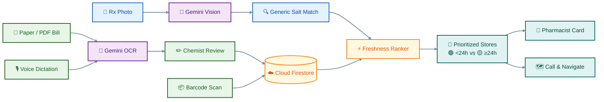
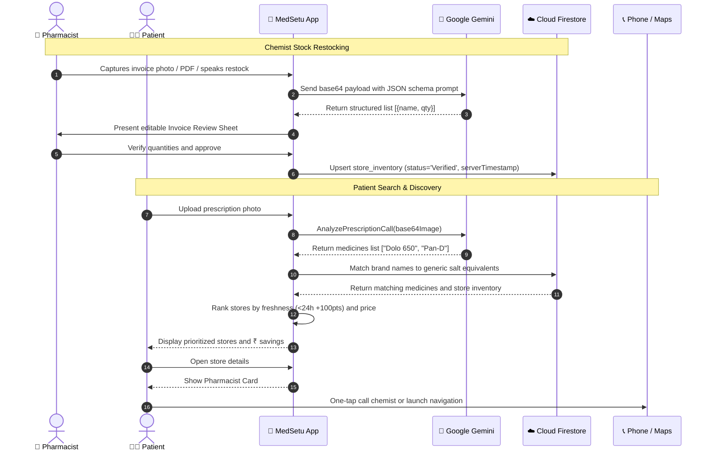

<div align="center">

  

  <h1 align="center">💊 MedSetu</h1>

  <p align="center">
    <strong>Real-time pharmacy inventory discovery and handwritten prescription decoding for affordable generic medicines.</strong>
  </p>

  <p align="center">
    <a href="https://flutter.dev"></a>
    <a href="https://dart.dev"></a>
    <a href="https://ai.google.dev"></a>
    <a href="https://firebase.google.com"></a>
  </p>

  <p align="center">
    <a href="#-the-problem--the-solution">Problem & Solution</a> •
    <a href="#-see-it-in-action">See It in Action</a> •
    <a href="#-key-features">Key Features</a> •
    <a href="#-how-it-works">How It Works</a> •
    <a href="#-run-locally">Run Locally</a> •
    <a href="#-tech-stack">Tech Stack</a> •
    <a href="#-project-structure">Project Structure</a>
  </p>

</div>

---

## 🔍 The Problem & The Solution

Government generic pharmacy initiatives such as the Pradhan Mantri Bhartiya Janaushadhi Pariyojana (PMBJP) offer high-quality medicines at a fraction of commercial prices. Despite this, patients across India continue to overpay for expensive branded drugs or travel across town only to encounter empty pharmacy shelves—a problem known as "ghost stock." Doctors write shorthand brand names that patients cannot decipher, while busy pharmacy owners lack the time to manually update central inventory software.

MedSetu bridges this communication gap. Pharmacy owners update their live shelves in seconds through camera invoice snapshots, distributor PDFs, voice dictation, or barcode scans. Patients take a photo of their handwritten prescription to identify prescribed drugs, uncover bio-equivalent generic salts with direct price comparisons, and find nearby pharmacies that verified physical stock within the last 24 hours.

| Problem Area | Traditional Experience | MedSetu Experience |
| :--- | :--- | :--- |
| **Prescription Reading** | Patients struggle to read physician handwriting and brand shorthand. | Gemini Vision extracts brand and generic drug names directly from camera photos. |
| **Generic Substitution** | Patients do not know which low-cost generic salt matches their brand. | Automatic salt mapping displays bio-equivalent generics and direct price savings in ₹. |
| **Stock Accuracy** | Central directories report catalog availability while shelves sit empty. | Freshness scoring highlights 🟢 **Verified Stock (<24h)** vs 🟡 **Likely Stock (≥24h)**. |
| **Inventory Logging** | Pharmacists face tedious item-by-item manual entry into desktop ERPs. | Four fast-restock modalities: distributor photo OCR, PDF bills, voice, and barcode scanning. |
| **Dispensing Safety** | Unregulated app suggestions create patient uncertainty. | In-app **Pharmacist Card** prompts a licensed chemist to confirm substitution at the counter. |

---

## 🎬 See It in Action

MedSetu tailors its interface to whichever role you select on launch:

1. **Patient Discovery**:
   - Tap **Find Medicines** from the home screen and acknowledge the pharmacist consultation reminder.
   - Snap a picture of your doctor's prescription or type a medicine name.
   - MedSetu runs multimodal analysis on the image and returns identified medicines:
     ```json
     {
       "medicines": ["Dolo 650", "Pan-D"]
     }
     ```
   - The results screen reveals matching Jan Aushadhi generic alternatives, displaying price comparisons side-by-side (for example, generic Paracetamol at ₹6.50 vs branded alternatives at ₹32.00).
   - Nearby pharmacies appear ranked by stock freshness. Selecting a store displays the **Pharmacist Card** for counter verification, along with one-tap calling and route navigation.

2. **Chemist Inventory Ingestion**:
   - Tap **Manage Pharmacy** and sign in to access your pharmacy dashboard.
   - Choose your restocking modality:
     - **Scan Invoice**: Capture a photo of a distributor paper bill to parse medicine rows and quantities.
     - **Upload PDF**: Select a wholesale digital invoice file for automated extraction.
     - **Voice Mode**: Dictate received stock (e.g., *"Received 50 strips of Metformin 500mg"*).
     - **Scan Medicine Box**: Point the camera at blister pack barcodes for immediate `+1` stock increments.
   - Review and tweak quantities on the interactive bottom sheet before committing verified records to the cloud database.

---

## ✨ Key Features

- **Decipher messy doctor prescriptions without guesswork**: Upload a camera photo of handwritten prescriptions to extract medication names while filtering out dosage numbers and frequencies.
- **Uncover low-cost generic substitutes without manual research**: Cross-reference prescribed commercial brands with bio-equivalent generic salts and view direct savings in ₹.
- **Avoid wasted trips to empty shelves without making phone calls**: View nearby pharmacies ranked by physical stock freshness, clearly separating stock verified within 24 hours from older catalog listings.
- **Restock inventory without manual typing**: Ingest medicine batches using paper invoice photos, wholesale PDFs, or natural voice dictation.
- **Restock cartons instantly with hardware scanning**: Scan blister pack and medicine box barcodes with your device camera to log atomic quantity increments.
- **Prevent AI data inaccuracies with human-in-the-loop validation**: Inspect and adjust AI-extracted invoice quantities on an interactive review sheet before writing to your store records.
- **Support dispensing safety with the Pharmacist Card**: Present an in-app counter token to your local chemist to verify chemical bio-equivalence before purchasing Schedule H medicines.

---

## ⚙️ How It Works

MedSetu connects two synchronized workflows through Cloud Firestore and Google Gemini. On the supply side, pharmacists ingest physical inventory via invoice images, PDF bills, barcode scans, or voice dictation; Gemini structures these into verified stock items stamped with server timestamps. On the demand side, patients photograph prescriptions or search by name; Gemini extracts the drug names, the catalog identifies matching generic salts, and the ranking algorithm prioritizes pharmacies that verified stock within the past 24 hours.



<div align="center">
  <sub>Dual-agent flow: supply-side rapid restocking meets demand-side prescription decoding and freshness-based pharmacy ranking.</sub>
</div>

<details>
<summary><b>🔍 View detailed request and verification sequence (click to expand)</b></summary>



</details>

---

## 🚀 Run Locally

Follow these steps to run MedSetu on your development machine or mobile device.

### 1. Prerequisites

Ensure you have the following installed with versions matching the repository requirements:

- **Flutter SDK**: `3.x` (Dart SDK `>= 3.0.0 < 4.0.0` from [flutter.dev](https://docs.flutter.dev/get-started/install))
- **Android SDK**: Compile SDK `35`, Min SDK `23`, Target SDK `35` (configured via Android Studio) or Xcode for iOS
- **Node.js**: `20.x` (required only if deploying or running Firebase Cloud Functions locally)

### 2. Clone the Repository

```bash
git clone https://github.com/Parth-Chavan-15/MedSetu-TechSprint.git
cd MedSetu-TechSprint
```

### 3. Install Dependencies

Install all Flutter and Dart package dependencies defined in the project:

```bash
flutter pub get
```

### 4. Configure Environment & API Services

MedSetu relies on Google Gemini for multimodal AI extraction and Firebase for database storage and authentication.

| Configuration Item | What It Is For | Where Used in Code | Required | Where to Obtain |
| :--- | :--- | :--- | :---: | :--- |
| **Gemini API Key** | Powers prescription OCR, invoice document parsing, and voice NLP. | `lib/backend/gemini/gemini.dart`<br/>`lib/backend/api_requests/api_calls.dart` | Yes | [Google AI Studio](https://aistudio.google.com/) |
| **`google-services.json`** | Connects Android builds to Firebase Firestore and Authentication. | `android/app/google-services.json` | Yes (Android) | [Firebase Console](https://console.firebase.google.com/) |
| **`GoogleService-Info.plist`** | Connects iOS builds to Firebase services. | `ios/Runner/GoogleService-Info.plist` | Yes (iOS) | [Firebase Console](https://console.firebase.google.com/) |

> [!IMPORTANT]
> Keep your private API keys secure. Never commit personal keys or production credentials to public version control.

### 5. Build Preparation

Perform a clean build to ensure all generated platform channels and bindings resolve:

```bash
flutter clean
flutter pub get
```

### 6. Start the Application

Launch the application on an attached physical device, emulator, or web browser:

```bash
# Run on default connected device or emulator
flutter run

# Or run in Google Chrome
flutter run -d chrome
```

### 7. What Success Looks Like

When the application boots successfully, you will see the MedSetu welcome screen featuring the circular MedSetu logo and two primary options:

- **Find Medicines**: Opens the patient prescription scanner and generic medicine directory.
- **Manage Pharmacy**: Opens the chemist authentication portal and inventory restocking dashboard.

---

## 💡 Usage

### Flow 1: Patient Medicine Discovery
1. Tap **Find Medicines** on the welcome screen and accept the consultation disclaimer.
2. Tap **Scan Now** to photograph a prescription, or enter a brand name in the search bar.
3. Review the matched generic salt name and estimated cost savings.
4. Browse nearby pharmacies tagged with 🟢 **Verified In-Stock** (restocked today) or 🟡 **Likely In-Stock** (baseline catalog).
5. Open the pharmacy details page to view the **Pharmacist Card** for counter presentation, or tap **Call** to check directly.

### Flow 2: Chemist Stock Restocking
1. Tap **Manage Pharmacy** on the welcome screen and sign in with your chemist account.
2. From the restock screen, select **Scan Invoice**, **Upload PDF**, **Scan Medicine Box**, or **Voice Mode**.
3. After Gemini parses your document or speech, inspect the extracted medicine names and quantities on the **Invoice Review Sheet**.
4. Confirm the entries to instantly write verified stock updates to Cloud Firestore.

---

## 🛠️ Tech Stack

- **Flutter & Dart**: Cross-platform application framework powering mobile and web user interfaces.
- **Google Gemini 2.5 Flash / 1.5 Pro**: Multimodal AI model performing handwritten prescription OCR, distributor invoice data extraction, and voice text processing.
- **Cloud Firestore**: Real-time cloud database managing pharmacy inventory records, store profiles, and the master generic medicine catalog.
- **Firebase Authentication**: User and pharmacy owner authentication supporting secure portal access.
- **Flutter Barcode Scanner**: Hardware camera integration for scanning blister pack and carton barcodes during restocking.
- **Geolocator & URL Launcher**: Location-based store distance calculation, native phone dialer integration, and map routing deep links.

---

## 📁 Project Structure

```text
MedSetu-TechSprint/
├── android/                 # Android native project and Gradle configuration
├── ios/                     # iOS native workspace and Podfile
├── assets/                  # Application fonts and brand images
│   └── images/              # MedSetu logo asset (WhatsApp_Image_2026-01-14_at_20.38.53.jpeg)
├── firebase/                # Firestore rules, security indexes, and Cloud Functions
│   └── functions/           # Node.js Firebase functions
├── lib/                     # Application source code
│   ├── authentication_pages/# Chemist login, gate check, and shop registration
│   ├── backend/             # Firebase configuration, Firestore schema, and Gemini API calls
│   ├── custom_code/         # Base64 image converters and search reference helpers
│   ├── flutter_flow/        # Theme definitions, navigation router, and custom functions
│   ├── home_page/           # Welcome screen and dual-role selector
│   ├── patient_pages/       # Prescription scanner, store results, and store navigator
│   ├── seller_pages/        # Restock modalities, invoice review sheet, and barcode scanner
│   └── main.dart            # Application entry point and router initialization
└── pubspec.yaml             # Dart environment and Flutter package dependencies
```

---

## 👥 Author & Context

- **Developer**: [Parth Chavan](https://github.com/Parth-Chavan-15)
- **Hackathon**: Developed for the **GDG VESIT TechSprint**
- **Repository**: [Parth-Chavan-15/MedSetu-TechSprint](https://github.com/Parth-Chavan-15/MedSetu-TechSprint)
- **License**: No formal license file is currently included in the repository.
