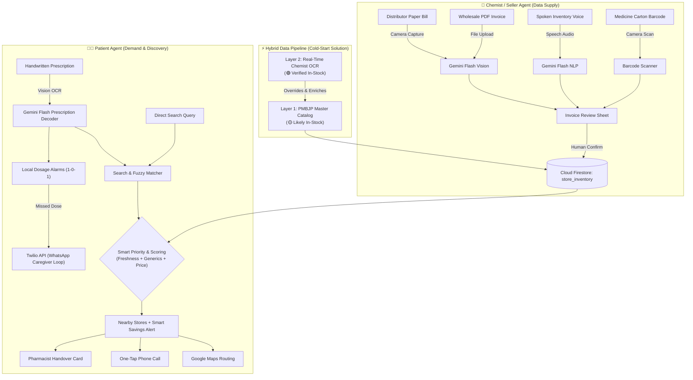

<div align="center">

  

  # 💊 MedSetu (जन सेतु)
  ### *Bridging the gap between a doctor's handwriting and government inventory.*

  **Built for the GDG VESIT TechSprint Hackathon**  
  **Created by [Parth Chavan](https://github.com/Parth-Chavan-15)**

  [](https://flutter.dev)
  [](https://flutterflow.io)
  [](https://ai.google.dev/)
  [](https://firebase.google.com)
  [](https://developers.google.com/maps)
  [](https://www.twilio.com)
  [](LICENSE)

  <p align="center">
    <strong>MedSetu</strong> is a <b>Dual-Agent Healthcare Ecosystem</b> designed to solve the critical "last-mile" failure of the <i>Pradhan Mantri Bhartiya Janaushadhi Pariyojana (PMBJP)</i>. It couples <b>zero-click multimodal inventory digitization</b> for local chemists with a <b>visual prescription AI decoder</b> and <b>safe generic-substitution routing</b> for patients.
  </p>

  [The "Ghost Stock" Reality](#-the-problem-the-ghost-stock-reality) • [The MedSetu Solution](#-the-medsetu-solution) • [Key Features](#-core-features) • [System Architecture](#-system-architecture) • [Safety Protocols](#-medical-liability--safety-protocols) • [Local Setup](#-getting-started-local-setup)

</div>

---

## 🚨 The Problem: The "Ghost Stock" Reality

The Government of India’s **Pradhan Mantri Bhartiya Janaushadhi Pariyojana (PMBJP)** provides quality generic medicines at **50% to 90% lower prices** than branded alternatives. 

While official apps like *Jan Aushadhi Sugam* allow citizens to locate stores and browse catalogs, they fail in practice at the **"last mile"** due to three compounding real-world challenges:

```
[Messy Doctor Prescription] ──❌ Confusion──> [Patient (Cannot decode chemical salts)]
                                                              │
                                                        Travels to Store
                                                              ▼
[Store Inventory: "Ghost Stock"] ──❌ Disappointment──> [Kendra is OUT OF STOCK]
```

1. **The "Ghost Store" Dilemma**: Local Jan Aushadhi Kendra operators lack modern automated ERPs and simply do not have the time for tedious manual inventory entry. As a result, central databases show medicines as available when physical shelves are completely empty.
2. **The Handwriting & Salt-Name Barrier**: Patients—especially elderly citizens—struggle to read doctors' handwriting and do not know the underlying chemical "salt" names (e.g., matching *Dolo 650* or *Calpol* to generic *Paracetamol 650mg*).
3. **Frustrating Wasted Journeys**: Patients travel across town to Jan Aushadhi stores only to find medicines out of stock, forcing them to buy expensive commercial brands out-of-pocket.

---

## 💡 The MedSetu Solution

**MedSetu** shifts the technological approach from *passive database searching* to **AI-driven Data Supply**:

* **For Store Owners**: A **multimodal "zero-click" inventory updater** that converts paper invoices, wholesale PDF bills, medicine barcodes, and voice notes into live database entries in seconds.
* **For Patients**: A **visual prescription decoder** that extracts doctor-written medicines, matches them to bio-equivalent generic salts, displays side-by-side cost savings, and verifies live store stock before the patient leaves home.

---

## ✨ Core Features

### 🏪 For Sellers ("The Lazy Worker" Zero-Click Automation)

* **📸 Invoice OCR Injection**: Pharmacists simply photograph a distributor's paper bill. **Google Gemini Flash Vision** extracts medicine names and batch quantities into structured JSON, staging the inventory update automatically.
* **📄 Wholesale PDF Ingestion**: Directly upload digital distributor PDF invoices to parse entire batches in one tap.
* **🎙️ Voice-to-Ledger Dictation**: Tap the mic and speak naturally:  
  * *"Received 50 strips of Metformin 500mg and 20 bottles of Cetirizine."*  
  Gemini extracts entities and automatically corrects phonetic spelling variations common in Indian pharmaceutical brand names.
* **📦 Barcode Restocking**: Integrated camera barcode scanner (`flutter_barcode_scanner`) reads 1D/2D barcodes on medicine cartons and blister strips for rapid `+1` inventory logging.
* **🧑‍💻 Human-in-the-Loop Validation**: To prevent AI hallucinations from polluting records, the system displays an interactive **Invoice Review Sheet** for quick verification before pushing to Cloud Firestore.

---

### 🧑‍🦳 For Patients (The Demand Side)

* **👁️ Visual Prescription Decoder**: Upload a photo of a messy, handwritten prescription. Gemini Vision OCR identifies branded medications, filters out handwriting artifacts, and maps them to approved generic chemical salts.
* **🟢 Verified In-Stock vs. 🟡 Likely In-Stock**:
  * 🟢 **Verified Stock (< 24 hrs)**: Chemist actively confirmed stock through invoice OCR, voice, or barcode within the last day.
  * 🟡 **Likely In-Stock (≥ 24 hrs)**: Baseline stock based on PMBJP mandatory catalog data.
* **💰 Smart Saving Alert**: Side-by-side price comparison showing the branded drug's MRP vs. the Jan Aushadhi generic alternative price, highlighting total ₹ saved.
* **🤝 The "Pharmacist Card" (Liability Shield)**: MedSetu does not prescribe; it informs. It generates an in-app verification token:
  > *"Hello Pharmacist, please verify if [Generic Salt] is a medically valid substitute for prescribed [Branded Drug]."*  
  This shifts final validation to the licensed chemist at the counter while protecting the patient.
* **🗺️ In-App Route Preview & Deep Navigation**: In-app Google Maps Directions API polyline preview with a single tap to launch native Google Maps with live navigation or call the chemist directly.
* **⏰ Caregiver Loop & Offline Alarms**: Automatically schedules local offline dosage reminders (e.g., `1-0-1` regimens). If an elderly patient misses a dose, the **Twilio WhatsApp API** automatically notifies their registered caregiver.

---

## 🏗️ System Architecture



---

## ⚡ The Hybrid Data Pipeline (Solving the "Cold Start")

To ensure MedSetu is useful from Day 1—even before every neighborhood chemist digitizes their inventory—the platform deploys a two-tier data architecture:

$$\text{Total Catalog} = \text{Layer 1 (Baseline Assumption)} \cup \text{Layer 2 (Live Chemist Overrides)}$$

1. **Layer 1 (Assumption Data — 🟡 Likely In-Stock)**:
   A baseline dataset containing mandatory PMBJP generic medicines mapped across registered Janaushadhi Kendras, tagged with an amber badge indicating likely availability.
2. **Layer 2 (Verified Data — 🟢 Verified In-Stock)**:
   Real-time inventory injected through the Seller Ingestion Engine (Invoices, PDF, Barcode, Voice). This overrides baseline assumptions, upgrades the badge to green, and boosts store search ranking.

### 🎯 Priority Ranking Formula (`sortInventoryByPriority`)

$$\text{Store Rank Score} = (100 \times \mathbb{I}_{\text{Fresh < 24h}}) + (10 \times \mathbb{I}_{\text{Is Generic}}) + \text{Price Rank}$$

```dart
// Freshness Tier (< 24 hours): +100 pts (Guarantees zero ghost-stock visits)
final bool aFresh = now.difference(aTime).inHours < 24;
if (aFresh) scoreA += 100;

// Generic Preference: +10 pts (Jan Aushadhi Kendra prioritization)
if (a.isGeneric == true) scoreA += 10;

// Tie-Breaker: Lowest Unit Price First
return aPrice.compareTo(bPrice);
```

---

## 🛡️ Medical Liability & Safety Protocols

Healthcare applications require zero tolerance for unverified dispensation. MedSetu enforces **three invisible safety guards**:

| Guard | Mechanism | Purpose |
| :--- | :--- | :--- |
| **1. The Pharmacist Handshake** | Dynamic In-App Handover Token | Shifts substitution liability to the registered pharmacist before medicine is dispensed. |
| **2. Mandatory Gate Disclaimer** | Enforced First-Launch Modal | Clarifies that MedSetu is a generic-discovery bridge, not a prescribing medical entity. |
| **3. OCR Confidence Gating** | Gemini Quality Threshold Check | If an invoice or prescription is illegible, blurry, or low-confidence, the confirm action locks, prompting a clean retake. |

---

## 🗄️ Firestore Database Schema

```
├── 📁 medicines/              # Master catalog of chemical salts & branded drugs
│   ├── brand_name: String           (e.g., "Dolo 650")
│   ├── generic_name: String         (e.g., "Paracetamol 650mg")
│   ├── is_generic: Boolean          (true if generic Jan Aushadhi formulation)
│   ├── generic_source_ref: Ref      (Points to parent generic salt document)
│   ├── std_price: Double            (Standard retail market price)
│   ├── barcode: String              (EAN/UPC identifier)
│   └── search_keywords: String      (Fuzzy search indexing string)
│
├── 📁 stores/                 # Registered pharmacy & Kendra profiles
│   ├── store_name: String           (e.g., "Pradhan Mantri Jan Aushadhi Kendra #104")
│   ├── owner_uid: String            (Firebase Auth UID)
│   ├── license_number: String       (State Drug License registration)
│   ├── phone_number: String         (Direct contact for patient queries)
│   ├── location: LatLng             (Geographic coordinates)
│   └── is_generic_store: Boolean    (true if authorized PMBJP outlet)
│
├── 📁 store_inventory/        # The bridging collection connecting stores to stock
│   ├── store_ref: Ref               (Reference to stores document)
│   ├── medicine_id: Ref             (Reference to medicines document)
│   ├── qty_in_stock: Int            (Available physical units)
│   ├── unit_price: Double           (Store-level pricing)
│   ├── status: String               ("Verified" vs "Likely")
│   └── last_updated: Timestamp      (Used for < 24h freshness calculation)
│
└── 📁 users/                  # Patient profiles & Caregiver contact loop
    ├── display_name: String
    ├── phone: String                (Patient contact)
    └── caregiver_phone: String      (WhatsApp notification target for Twilio)
```

---

## 🛠️ Tech Stack Matrix

| Layer | Technology | Role & Justification |
| :--- | :--- | :--- |
| **Frontend Framework** | **Flutter / FlutterFlow** | Cross-platform (Android, iOS, Web) native performance and clean responsive architecture. |
| **Database & Sync** | **Firebase Firestore** | Real-time NoSQL syncing across chemist portals and patient devices. |
| **Authentication** | **Firebase Auth** | OTP-based phone login and email/password shopkeeper authentication. |
| **AI Brain** | **Google Gemini Flash** | High-speed multimodal vision for handwriting OCR, invoice table parsing, and voice NLP. |
| **Maps & Routing** | **Google Maps API** | Accurate distance calculations, in-app polyline previews, and deep-link routing. |
| **Caregiver Alerts** | **Twilio WhatsApp API** | Automated WhatsApp notifications sent to caregivers when dosage alarms are missed. |
| **Hardware Access** | **Device Camera & Barcode** | Integrated barcode scanner and camera capture for invoice ingestion. |

---

## 🚦 Getting Started (Local Setup)

### 1. Prerequisites
* [Flutter SDK](https://docs.flutter.dev/get-started/install) (`>= 3.0.0 < 4.0.0`)
* Dart SDK (`>= 3.0.0`)
* Android Studio / Xcode (with simulators/emulators)
* A [Firebase Console](https://console.firebase.google.com/) Project
* A [Google AI Studio](https://aistudio.google.com/) API Key (Gemini)
* A [Google Cloud Console](https://console.cloud.google.com/) Maps API Key
* A [Twilio Account](https://www.twilio.com/) (Optional: for Caregiver WhatsApp Loop)

### 2. Clone the Repository
```bash
git clone https://github.com/Parth-Chavan-15/Jan-Setu-TechSprint.git
cd Jan-Setu-TechSprint
```

### 3. Configure Environment Variables
Create a `.env` file in the project root:
```env
# Google AI Studio Gemini API Key
GEMINI_API_KEY=your_gemini_api_key_here

# Google Maps Platform Key
GOOGLE_MAPS_API_KEY=your_google_maps_key_here

# Twilio Caregiver Loop Credentials (Optional)
TWILIO_ACCOUNT_SID=your_twilio_account_sid
TWILIO_AUTH_TOKEN=your_twilio_auth_token
TWILIO_WHATSAPP_NUMBER=whatsapp:+14155238886
```

### 4. Firebase Configuration
1. Create a Firebase project at [console.firebase.google.com](https://console.firebase.google.com/).
2. Enable **Authentication** (Email/Password & Phone OTP), **Firestore Database**, and **Storage**.
3. Place your platform-specific configuration files:
   * **Android**: `android/app/google-services.json`
   * **iOS**: `ios/Runner/GoogleService-Info.plist`

### 5. Install Packages & Run
```bash
# Clean and install dependencies
flutter clean
flutter pub get

# Run on connected device or emulator
flutter run

# Run on Web (Chrome)
flutter run -d chrome
```

---

## 📱 User Walkthrough

```
┌─────────────────────────────────────────────────────────────┐
│                    MedSetu Welcome Screen                   │
│             "Please select your role to continue"           │
└──────────────────────────────┬──────────────────────────────┘
                               │
               ┌───────────────┴───────────────┐
               ▼                               ▼
    ┌───────────────────────┐       ┌───────────────────────┐
    │  🟢 Patient / Buyer   │       │  🔵 Chemist / Seller  │
    └──────────┬────────────┘       └──────────┬────────────┘
               │                               │
        Safety Disclaimer               Store Auth & Gate
               │                               │
   ┌───────────┴───────────┐                   ▼
   │ Patient Search Engine │       ┌───────────────────────┐
   │ • Rx Photo OCR        │       │   Seller Dashboard    │
   │ • Medicine Search Bar │       └───────────┬───────────┘
   └───────────┬───────────┘                   │
               │                      4 Ingestion Modalities:
               ▼                      ├── 1. Invoice Image OCR
   ┌───────────────────────┐          ├── 2. Invoice PDF Parser
   │  Stores Near You      │          ├── 3. Barcode Scanner
   │ • 🟢 Verified (<24h)  │          └── 4. Voice Dictation
   │ • Smart Saving Alert  │                   │
   │ • Call Chemist        │                   ▼
   │ • In-App Map Preview  │       ┌───────────────────────┐
   │ • Pharmacist Card     │       │ Invoice Review Sheet  │
   └───────────────────────┘       │ (Human-in-the-Loop)   │
                                   └───────────┬───────────┘
                                               │
                                               ▼
                                      [Cloud Firestore Sync]
```

---

## 🏆 Hackathon Context

* **Event**: GDG VESIT TechSprint Hackathon
* **Track**: Healthcare Accessibility & AI Innovation
* **Mission**: Eliminating out-of-pocket medical expenditure by bringing real-time data transparency to the *Pradhan Mantri Bhartiya Janaushadhi Pariyojana (PMBJP)*.

---

## 👨‍💻 Author

**Parth Chavan**
* GitHub: [@Parth-Chavan-15](https://github.com/Parth-Chavan-15)
* Repository: [Jan-Setu-TechSprint](https://github.com/Parth-Chavan-15/Jan-Setu-TechSprint)

---

<div align="center">
  <sub>Built with ❤️ by Parth Chavan for accessible, affordable healthcare in India. 🇮🇳</sub>
</div>
